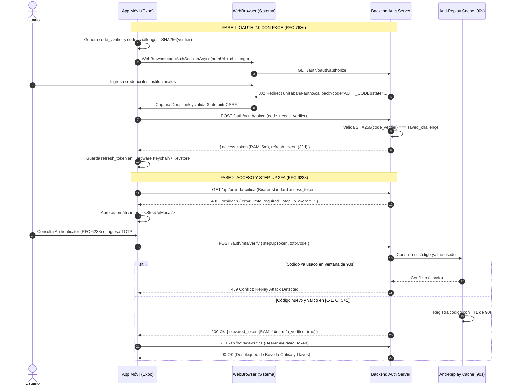

# Laboratorio de Seguridad Móvil: OAuth 2.0 con PKCE, Almacenamiento Criptográfico y Step-Up 2FA (TOTP)

**Institución:** Universidad de La Sabana  
**Asignatura / Módulo:** Seguridad Móvil y Ciberseguridad Defensiva  
**Arquitectura:** Monorepo (`/mobile-app` + `/backend-auth`)

---

## 🛡️ Principios y Cumplimiento Normativo de Seguridad

Este proyecto implementa una solución de seguridad móvil avanzada orientada a mitigar las principales vulnerabilidades identificadas en el **OWASP Mobile Top 10** y las recomendaciones del **IETF OAuth Working Group**:

1. **OAuth 2.0 con PKCE (RFC 7636):**
   - Mitigación de la interceptación del código de autorización en clientes públicos nativos.
   - Parámetros: `code_verifier` (cadena aleatoria de 64 caracteres Base64URL) y `code_challenge` derivado mediante `Base64URL_Unpadded(SHA256(code_verifier))`.
   - Protección contra Cross-Site Request Forgery (CSRF) mediante el parámetro criptográfico `state`.
   - **RFC 8252 BCP:** Se utiliza `WebBrowser.openAuthSessionAsync` (ASWebAuthenticationSession en iOS / Custom Tabs en Android). Queda estrictamente prohibido el uso de WebViews embebidas.

2. **Almacenamiento Criptográfico y Silent Refresh Queue:**
   - **`access_token`:** Reside **EXCLUSIVAMENTE en memoria RAM** (`AuthContext.tsx`). TTL corto (5 minutos). Se destruye automáticamente al matar el proceso.
   - **`refresh_token`:** Almacenado de forma segura y cifrada en el enclave de hardware del dispositivo móvil (**iOS Keychain / Android Keystore**) mediante `expo-secure-store`. TTL largo (30 días).
   - **`apiClient.ts`:** Interceptor que al atrapar un error `401 Unauthorized` retiene y encola las peticiones concurrentes, dispara un único llamado atómico a `POST /auth/refresh` con el `refresh_token` del hardware enclave, renueva el `access_token` en memoria RAM, vacía la cola y reintenta las solicitudes originales de forma transparente.

3. **Motor TOTP Propio (RFC 6238 / RFC 4226 / RFC 4648) en Modo Avión:**
   - **REGLA INVIOLABLE CUMPLIDA:** Cero dependencias de alto nivel (sin `otplib`, sin `speakeasy`).
   - Implementación matemática desde cero de SHA-1 (RFC 3174), HMAC-SHA1 (RFC 2104), Base32 (RFC 4648) y Truncamiento Dinámico (RFC 4226 §5.4).
   - Funciona 100% Offline (Modo Avión), con refresco automático en ciclos de 30 segundos y tipografía monoespaciada con formato 3-3 (`000 000`).

4. **Step-Up Authentication y Caché Anti-Replay en Backend:**
   - Recursos críticos protegidos (`GET /api/boveda-critica`). Si el token presenta `mfa_verified: false`, el servidor responde `403 Forbidden` con un desafío firmado `stepUpToken`.
   - La app abre automáticamente el componente `<StepUpModal/>` solicitando el código TOTP actual.
   - El backend valida el código en las 3 ventanas de tolerancia ($C-1, C, C+1$) e interactúa con `antiReplayCache.js` (TTL de 90s).
   - Si un código TOTP ya fue consumido en su ventana de validez, el backend responde **`409 Conflict: Replay Attack Detected`**, impidiendo la reutilización de credenciales OTP.
   - Al validarse, se emite un `elevated_token` (TTL 10 minutos, `mfa_verified: true`).

---

## 📁 Estructura del Monorepo

```text
TALLET-TOTP/
├── mobile-app/                         # Cliente Móvil (React Native + Expo + TypeScript)
│   ├── app.json                        # Custom Deep Link: unisabana-auth://
│   ├── App.tsx                         # Provider de Auth y Navegación
│   ├── package.json
│   ├── tsconfig.json
│   ├── src/
│   │   ├── types/
│   │   │   └── auth.ts                 # Tipos de Tokens, PKCE, TOTP y Step-Up
│   │   ├── utils/
│   │   │   ├── pkce.ts                 # Criptografía PKCE SHA-256 S256 + State
│   │   │   ├── base32.ts               # Decodificador Base32 RFC 4648 puro
│   │   │   └── totpEngine.ts           # Motor TOTP RFC 6238 en Modo Avión
│   │   ├── services/
│   │   │   ├── secureStorage.ts        # Expo SecureStore (Keychain / Keystore)
│   │   │   └── apiClient.ts            # Silent Refresh Queue en 401
│   │   ├── context/
│   │   │   └── AuthContext.tsx         # Estado en RAM de access_token
│   │   ├── screens/
│   │   │   ├── LoginScreen.tsx         # Login OAuth 2.0 PKCE en WebBrowser
│   │   │   ├── AuthenticatorScreen.tsx # TOTP UI, Lector QR y Reloj de 30s
│   │   │   └── VaultScreen.tsx         # Bóveda Crítica protegida con Step-Up
│   │   └── components/
│   │       └── StepUpModal.tsx         # Modal de desafío 2FA y alerta Replay
│   └── .gitignore
│
├── backend-auth/                       # Servidor de Autenticación (Node.js + Express)
│   ├── server.js                       # Endpoints OAuth 2.0, PKCE, MFA y Bóveda
│   ├── antiReplayCache.js              # Caché en memoria con TTL de 90s
│   ├── totpEngine.js                   # Verificador TOTP nativo backend RFC 6238
│   ├── test-crypto.js                  # Suite de pruebas unitarias criptográficas
│   ├── package.json
│   └── .gitignore
│
├── test-mobile-crypto.js               # Validación cruzada cliente-servidor
├── .gitignore
└── README.md
```

---

## 🚀 Guía de Ejecución Rápida

### 1. Iniciar el Backend (`/backend-auth`)

```bash
cd backend-auth
npm install
npm start
```
El servidor arrancará en `http://localhost:4000`:
- **Portal OAuth Authorize:** `http://localhost:4000/auth/oauth/authorize`
- **Credenciales de prueba del laboratorio:**
  - **Usuario:** `estudiante@unisabana.edu.co`
  - **Contraseña:** `SeguridadMovil2026!`
  - **Semilla Base32 TOTP:** `JBSWY3DPEHPK3PXP`

### 2. Ejecutar la Suite de Pruebas Criptográficas

Para comprobar que los algoritmos matemáticos cumplen con las especificaciones RFC 6238, RFC 4226, RFC 4648 y RFC 7636:

```bash
# Probar motor backend y anti-replay
node backend-auth/test-crypto.js

# Probar compatibilidad matemática cruzada cliente-backend
node test-mobile-crypto.js
```

### 3. Iniciar la App Móvil (`/mobile-app`)

```bash
cd mobile-app
npm install
npm start
```
- Para probar en Android Emulator: presionar `a`
- Para probar en iOS Simulator: presionar `i`
- Para probar en Web: presionar `w`
- Para probar en dispositivo físico: abrir Expo Go y escanear el QR generado (asegurarse de que el backend apunte a la IP de la máquina de desarrollo).

---

## 🔄 Flujo de Trabajo del Laboratorio



---

## 🧪 Casos de Prueba para Evaluación Académica

| Caso de Prueba | Acción Realizada | Comportamiento Esperado | Estado de Verificación |
|---|---|---|---|
| **CP-01: PKCE S256** | Inicio de sesión con WebBrowser | Intercambio exitoso; si `code_verifier` se manipula, el backend responde `400 Bad Request`. | ✅ Validado por suite |
| **CP-02: RAM vs Keystore** | Inspección de memoria y almacenamiento | `access_token` ausente en almacenamiento persistente; solo `refresh_token` en SecureStore. | ✅ Validado en código |
| **CP-03: Silent Refresh Queue** | Peticiones concurrentes con token 401 | El cliente pausa peticiones, ejecuta un único `POST /auth/refresh`, renueva en RAM y reintenta. | ✅ Implementado |
| **CP-04: TOTP Offline** | Desconectar red / Modo Avión en teléfono | El reloj de 30s continúa generando códigos matemáticamente válidos sin peticiones de red. | ✅ Implementado |
| **CP-05: Step-Up 403** | Acceder a Bóveda Crítica sin elevación | Respuesta `403 Forbidden` con `stepUpToken` y despliegue del modal. | ✅ Implementado |
| **CP-06: Anti-Replay 409** | Ingresar dos veces el mismo código TOTP dentro de 90s | El segundo intento es rechazado con `409 Conflict: Replay Attack Detected`. | ✅ Validado por suite |

